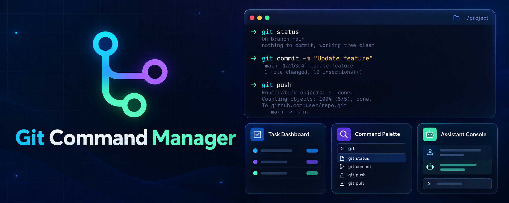

<h1 align="center">Git Command Manager v0.2.1</h1>

A Safe, Keyboard-First PowerShell Terminal App For Exploring Git, Managing Local Repositories, And Working With GitHub.

[Quick Start](#quick-start) | [Three Interface Modes](#three-interface-modes) | [Project Management](#project-management) | [Safety](#safety-and-privacy) | [Documentation](#documentation)

---

## Git Workflows, Your Way

Git Command Manager Brings Git's Command Catalog, Common Repository Workflows, And GitHub Project Controls Into A Responsive Terminal Interface. A Single Shared Engine Powers Every Interaction Style, So Validation, Settings, Command Execution, And Safety Rules Stay Consistent.

### Three Interface Modes

- **Task Dashboard** - The Default. Browse Organized Actions And Repository Tasks.
- **Command Palette** - Search Available Git Commands And Reach Advanced Operations Quickly.
- **Assistant Console** - Follow Guided Steps With Context, Validation, Previews, And Confirmations.

Change Modes From Settings Without Restarting. Your Preferred Mode Is Saved And Restored On The Next Launch.

### Project Management

- Create A New Empty Local Project Folder Or Clone An Existing GitHub Repository.
- Inspect Repository State, Remotes, Branches, Upstream, Ahead/Behind Counts, And Recent Commits.
- Connect, Verify, Change, And Remove Git Remotes While Preserving Local History.
- Review, Stage, Unstage, And Commit Changes As Separate, Visible Steps.
- Fetch, Fast-Forward-Only Pull, And Push With Explicit Confirmation.
- Create, Switch, Rename, Delete Safely, And Configure Tracking For Branches.
- Check GitHub CLI Availability And Authentication.
- Create A Private GitHub Repository And Edit Its Description, Homepage, Topics, Or Visibility When GitHub CLI Is Available.

## Quick Start

### Requirements

- Git Available On PATH.
- PowerShell 7 On Windows, Linux, Or macOS. Windows PowerShell 5.1 Is Also Supported On Windows.
- GitHub CLI (gh) Is Optional. It Is Needed Only For GitHub Page Creation And Metadata Editing.

### Launch

~~~powershell
pwsh -NoProfile -File .\Start-Git-Command-Manager.ps1
~~~

On Windows PowerShell 5.1:

~~~powershell
powershell.exe -NoProfile -File .\Start-Git-Command-Manager.ps1
~~~

Print The Installed App Version:

~~~powershell
pwsh -NoProfile -File .\Start-Git-Command-Manager.ps1 -Version
~~~

For GitHub Page Controls, Sign In With gh auth login Before Launching The App. The App Does Not Read Or Store Your GitHub Credentials.

## Safety And Privacy

- Git Processes Receive Validated Argument Arrays; User Input Is Never Executed As A Shell Script.
- Repository Creation, Staging, Commits, Remote Changes, Branch Changes, Pulls, And Pushes Require Clear Review Or Confirmation.
- Pull Uses Fast-Forward-Only Behavior. Force Push And Hard Reset Are Not Offered In Project Management.
- Public Visibility Changes Require A Dedicated Typed Confirmation.
- Remote Credentials And URL Query Strings Are Redacted In Interface Output.
- GitHub Page Features Use GitHub CLI's Existing Authentication. Credentials Are Not Displayed Or Persisted By This App.
- The App Does Not Install Git Or GitHub CLI, Elevate Privileges, Or Collect Telemetry.

## Documentation

- [Project Management Guide](docs/Project-Management-Guide.md)
- [Workflows](docs/Workflows.md)
- [Architecture](docs/Architecture.md)
- [Security Model](docs/Security.md)
- [Testing](docs/Testing.md)
- [Command Coverage](docs/Command-Coverage.md)
- [Problems And Solutions](docs/PROBLEMS_AND_SOLUTIONS.md)

## Development

Run The Unit And Integration Suite:

~~~powershell
pwsh -NoProfile -File .\tests\Run-Tests.ps1
~~~

The Test Suite Uses Temporary Repositories And Is Designed For PowerShell 7 And Windows PowerShell 5.1. See AGENT.md For Repository Engineering Rules.

---

**Git Command Manager** - Clear Git Workflows, Shared Safety, And A Terminal UI That Fits Your Style.
